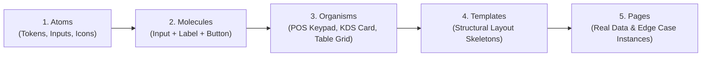

# Book 02: Atomic Design
**Author:** Brad Frost  
**Category:** Component Architecture & Design Systems  
**Relevance to SaaS & ERP:** Hierarchical UI Construction, Cross-Platform Token-to-Organism Mapping.

---

## 1. Executive Summary & Core Thesis
User interfaces should not be designed or developed as static, isolated pages. Instead, they should be crafted as structured, interconnected design systems inspired by chemistry: breaking interfaces into fundamental modular units that combine hierarchically to create complex, scalable software experiences.

---

## 2. The Five Atomic Levels & Enterprise Application

### Level 1: Atoms (الذرات)
* **Definition:** The fundamental, indivisible building blocks of the user interface.
* **In this architecture:**
  - **Tokens:** Color palette (brand, surface, semantic status: success/error/warning), spacing units (4px/8px scale), font weights, typography scale, border-radii, elevation shadows.
  - **Base Primitives:** `<Button>`, `<Input>`, `<Icon>`, `<Badge>`, `<Checkbox>`, `<Spinner>`.
  - *Rule:* Atoms are headless or abstract on their own. They do not hold business domain state.

### Level 2: Molecules (الجزيئات)
* **Definition:** Simple combinations of two or more atoms bonded together to serve a single, focused purpose.
* **In this architecture:**
  - Currency Amount Field: `<CurrencyInput>` (Atom Input + Atom EGP Currency Prefix + Atom Clear Icon).
  - Search Bar: `<SearchBar>` (Search Icon + Input + Clear Button).
  - Status Pill: `<StatusBadge>` (Dot Atom + Label Atom).
  - Quantity Stepper: `<QuantitySelector>` (Minus Button + Numeric Display + Plus Button).

### Level 3: Organisms (الكائنات الحية)
* **Definition:** Distinct, complex UI sections composed of molecules, atoms, and other organisms that handle concrete business interactions.
* **In this architecture:**
  - **POS Fast Keypad (`<PosNumpad>`):** Numeric grid, quick-cash buttons, enter/clear actions.
  - **KDS Ticket Card (`<KitchenTicketCard>`):** Header (elapsed timer, table number), line item list, modifier checklist, bump action button.
  - **Shift Drawer Modal (`<BlindShiftModal>`):** Denomination breakdown table, actual counted input, submission trigger.
  - **Floor Map Grid (`<TableFloorMap>`):** Dynamic SVG/Canvas grid rendering table nodes with covers and service statuses.

### Level 4: Templates (القوالب)
* **Definition:** Page-level structural wireframes that organize organisms into layout skeletons. They define responsive breakpoints, grids, and content zones without being tied to real data.
* **In this architecture:**
  - `<PosTerminalLayout>`: 3-column layout (Categories/Items on left, Cart in middle, Actions/Numpad on right).
  - `<AdminDashboardLayout>`: Collapsible sidebar, top header with tenant switcher, central data-table canvas.
  - `<MobileManagerLayout>`: Bottom navigation bar, swipeable cards, quick-approval action drawer.

### Level 5: Pages (الصفحات والتطبيقات الفعلية)
* **Definition:** Specific instances of templates populated with live, production-grade business state, mock fixtures, and edge cases.
* **In this architecture:**
  - Validating edge cases: What happens when an item name has 80 characters? What happens when a receipt has 150 items? What happens when network status changes to offline?

---

## 3. Core Principles for This Skill
1. **The Single-Direction Dependency Rule:** Atoms may never import Molecules or Organisms. Molecules may only import Atoms. Organisms may import Atoms and Molecules.
2. **Headless Domain Separation:** Atoms and Molecules must remain 100% agnostic of backend business logic (pure presentation & interaction). Domain awareness is injected only at the Organism and Page levels.
3. **Cascading Token Updates:** Changing an atomic token (e.g., surface border-radius or primary color) must cascade universally across Web, Desktop, and Mobile without editing individual component styles.
