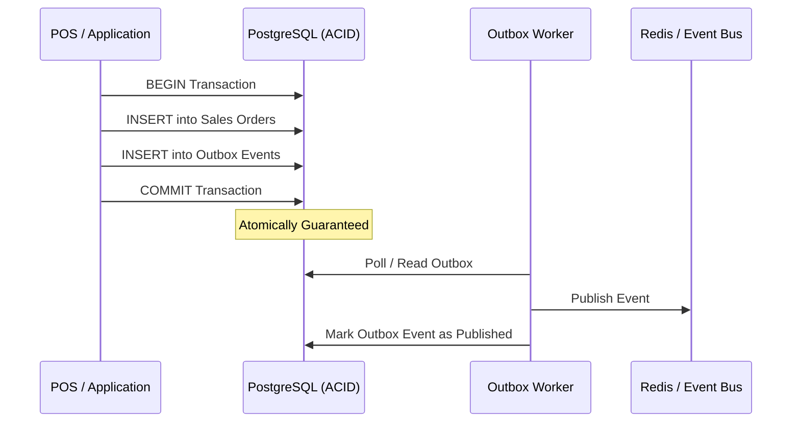

# Book 11: Designing Data-Intensive Applications (DDIA)
**Author:** Martin Kleppmann  
**Category:** Distributed Systems, Data Models & Scalability  
**Relevance to SaaS & ERP:** Reliable Offline Sync, Outbox Pattern, Eventual Consistency, Idempotency.

---

## 1. Executive Summary & Core Thesis
Software systems fail not because hardware is broken, but because software engineers make false assumptions about network reliability, clock synchronization, and data consistency. Martin Kleppmann provides the foundational principles for engineering reliable, scalable, and maintainable systems across heterogeneous data stores, distributed nodes, and asynchronous communication streams.

---

## 2. Core Methodologies & Architectural Pillars

### A. Reliability, Scalability, Maintainability (RSM)
* **Reliability:** Tolerating hardware, software, and human faults without catastrophic system failure.
* **Scalability:** Measuring performance under load using percentiles (p95, p99, p99.9) rather than misleading averages, and designing horizontal scaling mechanisms.
* **Maintainability:** Prioritizing **operability** (making operations and telemetry visible) and **simplicity** (managing accidental complexity).

### B. Distributed Systems Realities & The Fallacies of Computing
* **Unreliable Networks:** Networks drop, delay, duplicate, and reorder packets. Systems must never rely on network delivery for correctness.
* **Clock Drift:** Physical system clocks (Time-of-Day) skew and jump backwards during NTP syncs. **Never use local wall-clock timestamps for global transaction ordering.** Use monotonic clocks for durations and logical/causal sequence counters (or Lamport/vector clocks) for event ordering.

### C. The Transactional Outbox Pattern & Change Data Capture (CDC)
* **The Dual-Write Problem:** Updating a database table and publishing an event to a message queue in two separate steps leads to data corruption if the system crashes in between.
* **The Outbox Solution:** The business mutation and the outbound event record are committed inside the **exact same ACID database transaction**. A separate worker process polls or tails the outbox table to publish events with at-least-once delivery guarantees.

### D. Idempotency & Conflict Resolution in Hybrid Offline Sync
* **Idempotency Keys:** Every mutation originating on an edge device (POS) must carry a unique, client-generated UUID idempotency key:
  `Key = (organization_id, device_id, operation_id)`
  Replaying the exact same request must return the identical outcome without creating duplicate payments or inventory deductions.
* **Semantic Conflict Resolution:** Generic Last-Write-Wins (LWW) causes silent data loss. Financial and inventory records must be **append-only ledgers**, where conflicts are resolved by explicit reversal or human review queues, never blind overwrites.

---

## 3. Architectural Rules for This Skill
1. **The Transactional Outbox Invariant:** Any domain state change that triggers downstream side effects (inventory, notifications, accounting) must be committed atomically with an outbox record in the same database transaction.
2. **Deterministic Idempotency Rule:** All write APIs and sync endpoints must enforce idempotent request handling backed by unique compound database constraints.
3. **Monotonic Event Sequencing:** Offline mutation queues must rely on monotonic client-side sequence counters combined with logical server cursors, never physical device wall-clocks.
