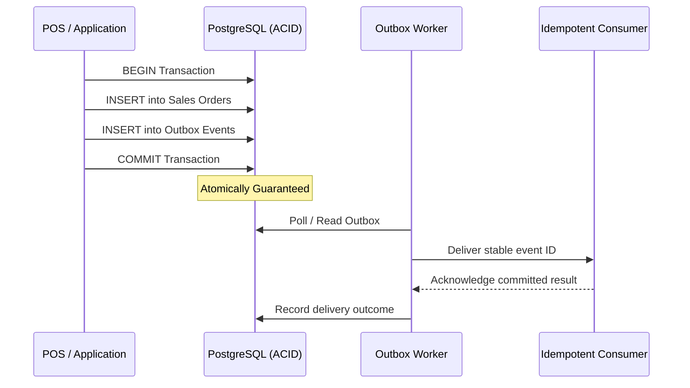

# Book 11: Designing Data-Intensive Applications (DDIA)
**Author:** Martin Kleppmann  
**Category:** Distributed Systems, Data Models & Scalability  
**Relevance to SaaS & ERP:** Reliable Offline Sync, Outbox Pattern, Eventual Consistency, Idempotency.

---

## 1. Executive Summary & Core Thesis
Martin Kleppmann treats hardware, software, human error, and network partial failures as inputs to reliable system design. Relevant sections in the local edition are Chapter 7 on transactions, Chapter 8 on partial failures, and Chapters 11–12 on idempotence and derived data. See [source evidence](source-evidence.md).

---

## 2. Core Methodologies & Architectural Pillars

### A. Reliability, Scalability, Maintainability (RSM)
* **Reliability:** Tolerating hardware, software, and human faults without catastrophic system failure.
* **Scalability:** Measuring performance under load using percentiles (p95, p99, p99.9) rather than misleading averages, and designing horizontal scaling mechanisms.
* **Maintainability:** Prioritizing **operability** (making operations and telemetry visible), **simplicity** (managing accidental complexity), and **evolvability** (making future change easier).

### B. Distributed Systems Realities & the Fallacies of Distributed Computing
*Source note: the "Fallacies of Distributed Computing" are commonly attributed to L. Peter Deutsch and colleagues at Sun Microsystems (with an eighth added later). DDIA discusses the realities behind them; the list is not Kleppmann's.*
* **Unreliable Networks:** Networks drop, delay, duplicate, and reorder packets. Systems must never rely on network delivery for correctness.
* **Clock Drift:** Physical system clocks (Time-of-Day) skew and jump backwards during NTP syncs. **Never use local wall-clock timestamps for global transaction ordering.** Use monotonic clocks for durations and logical/causal sequence counters (or Lamport/vector clocks) for event ordering.

### C. The Dual-Write Problem, Outbox, and Change Data Capture (CDC)
*Source note: DDIA analyzes dual writes and log-based integration/CDC in Chapter 11, but it does not present "Transactional Outbox" as a named DDIA pattern. The named pattern is commonly credited to Chris Richardson's microservices catalog. The outbox implementation below is added for this skill.*
* **The Dual-Write Problem:** A failure between a database commit and an independent publish can leave one effect recorded without the other.
* **The Outbox Solution:** The business mutation and outbound event commit atomically. A worker reads the outbox and delivers to a local consumer or a broker if the project uses one. The worker can fail after applying or publishing an event but before recording acknowledgement, so consumers make replay safe.

### D. Idempotency & Conflict Resolution in Hybrid Offline Sync
*Derived for this skill: DDIA provides the underlying theory (idempotence, exactly-once vs. at-least-once delivery, and causal ordering), but the API-level idempotency-key convention and append-only ledger rules below are implementation guidance for this domain.*
* **Idempotency Keys:** Universal ERP uses `(organization_id, device_id, device_epoch, operation_id)`. Persist the canonical versioned fingerprint and recorded result with the effect. Replay matching operations. Route changed content under the same key to review.
* **Stable Business Identity:** Restore or a different device can produce a different retry key for the same fact. Reconcile by sale or receipt ID and by receipt cycle for transfers. Store distinct claims for audit, normalize and compare business facts, and post the domain effect once.
* **Semantic Conflict Resolution:** Preserve posted money and stock records and resolve disputed facts with authorized review and linked corrections. See the [offline POS workflow](offline-pos-workflow.md).

---

## 3. Architectural Rules for This Skill
1. **The Transactional Outbox Invariant:** Any domain state change that triggers downstream side effects (inventory, notifications, accounting) must be committed atomically with an outbox record in the same database transaction.
2. **Deterministic Idempotency Rule:** All write APIs and sync endpoints must enforce idempotent request handling backed by unique compound database constraints.
3. **Monotonic Event Sequencing:** Offline mutation queues must rely on monotonic client-side sequence counters combined with logical server cursors, never physical device wall-clocks.
